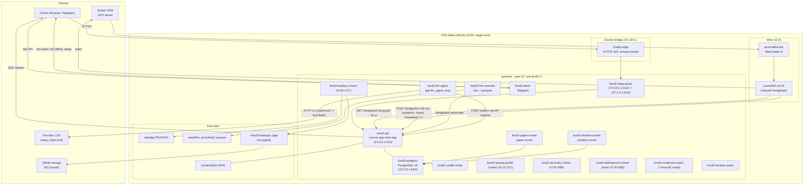
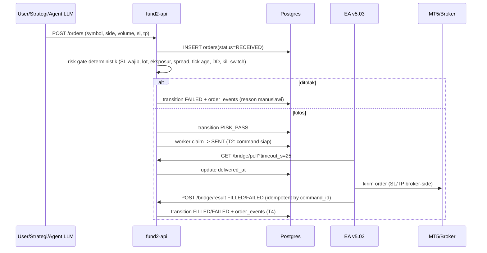
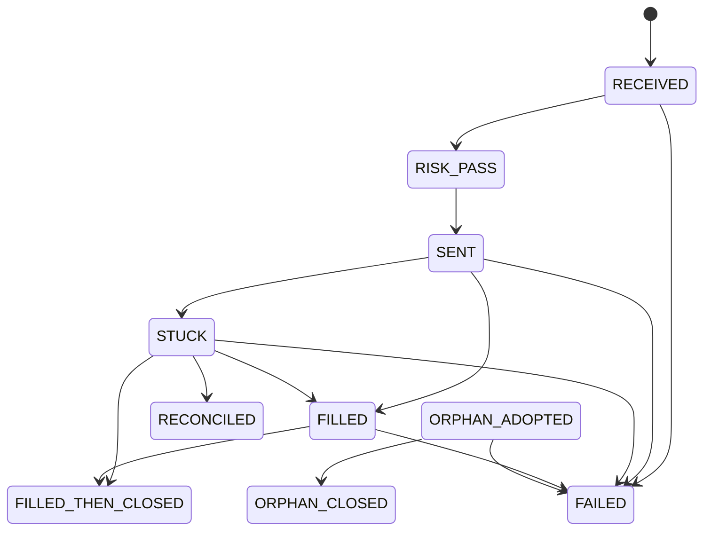

# Arsitektur Fund2 v2.2: Topologi, Alur Data, Batas Kepercayaan

Kartu: **t_f2v22a18** · Artefak Lampiran B butir "architecture diagram dan ADR" · Penyusun: hf-ceo
Tanggal: 26 Nov 2026 (WIB) · Status: **FINAL untuk rilis v2.2** (verifikasi runtime 26 Nov 2026 01:2x WIB)
Dokumen pendamping: `ADR_v2.2.md` (keputusan arsitektur), `THREAT_MODEL_v2.2.md`, `DATA_DICTIONARY_v2.2.md`, `API_EA_PROTOCOL_SPEC_v2.2.md`

Semua elemen di bawah diverifikasi dari host produksi (unit systemd, proses berjalan, port listen,
katalog PostgreSQL, dan OpenAPI aplikasi), bukan dari desain di atas kertas. Perintah verifikasi
dicantumkan di §10 supaya bisa diulang.

## 1. Ruang lingkup

Sistem: Lumine Fund v2.2 end-to-end, satu host VPS (`tekka`), akun broker HFM via MetaTrader 5,
satu EA (`LumineEA.mq5` v5.03), API FastAPI, PostgreSQL 16, runner paper/shadow, agent LLM,
UI kontrol plane, alert Telegram, dan backup offsite.

Di luar lingkup dokumen ini: infrastruktur broker (eksekusi diasumsikan benar, diverifikasi lewat
rekonsiliasi), penyedia data pasar, dan platform LLM pihak ketiga.

## 2. Topologi



Catatan yang mudah salah dibaca:

- **API hanya bind loopback (`127.0.0.1:3110`).** Akses dari Caddy (container, jaringan bridge) lewat
  `fund2-edge-proxy` yang membuka `172.19.0.1:3110`. EA tetap menembak `http://127.0.0.1:3110` langsung
  (PRD §7). Proxy tidak mengubah bind API dan tidak menambah jalur auth baru.
- **Tidak ada message broker.** Antrean command adalah tabel `orders` (`status='SENT' AND delivered_at IS NULL`)
  dengan `FOR UPDATE SKIP LOCKED`; antrean reconciler adalah `bridge_commands` (`status='QUEUED'`).
  Keputusan ini di ADR-003.
- **PostgreSQL native di host (port 5433), bukan container.** Keputusan di ADR-001.

## 3. Komponen

| Komponen | Unit / proses | Bind | Peran | Kode |
| --- | --- | --- | --- | --- |
| API + UI server | `fund2-api` (uvicorn `app.main:app`) | `127.0.0.1:3110` | REST 65 path, SSE `/stream`, serve SPA `frontend/dist`, worker claim + reconciler in-process | `api/app/` |
| Edge proxy | `fund2-edge-proxy` | `172.19.0.1:3110` | Jembatan docker-bridge → loopback untuk Caddy | `edge_proxy.py` |
| Caddy edge | container docker | `:443` | TLS + reverse proxy domain | infra host (di luar repo) |
| Database | `fund2-postgres` (PG 16) | `127.0.0.1:5433` | Sumber kebenaran: ledger append-only, settings, audit | `data/pg`, migrasi `api/alembic/` |
| EA | `LumineEA.mq5` v5.03 di MT5 (Wine) | klien | Eksekusi order, tick batch, snapshot posisi, heartbeat | `ea/LumineEA.mq5` |
| MT5 terminal | `terminal64.exe` (Wine 10.20) | klien | Koneksi broker, terminal chart | `legacy-v1-scripts/mt5-native-entrypoint.sh` |
| Recorder | `fund2-hfm-recorder` | - | Tick/spread → parquet + log, dasar kalibrasi biaya | `data/hfm_recording/recorder.py` |
| Paper runner | `fund2-paper-runner` (`paper.runner`) | - | Eksekusi sinyal mode PAPER (tanpa order broker) | `api/paper/` |
| Shadow runner | `fund2-shadow-runner` (`shadow.runner`) | - | Sinyal live tersimulasi, tanpa order (PRD §9) | `api/shadow/` |
| LLM agent | `fund2-llm-agent` (`app.llm_agent_loop`) | - | Siklus keputusan LLM (G1), order tetap lewat risk gate | `api/app/llm_*.py` |
| Alert daemon | `fund2-alerts` (`app.alerts`) | - | Telegram: kill-switch, EA offline, rekap harian | `api/app/alerts.py` |
| Candle rollup | `fund2-candle-rollup` | - | M1 → M5/M15/H1/H4 | `api/app/` rollup |
| Spread profile | `fund2-spread-profile` + timer | - | Profil spread harian + kalibrasi biaya BTC | `scripts/` |
| Anomaly detector | `fund2-anomaly` + timer (07:05 WIB) | - | Anomali latensi/spread/FAILED harian | `scripts/` |
| Self-improve | `fund2-selfimprove` + timer (Senin) | - | Proposal perbaikan mingguan | `api/app/` |
| Backup | `fund2-backup` + timer (04:30 UTC) | - | `pg_dump` + parquet + config → age → offsite | `scripts/fund2_backup.sh` |
| Model pin watch | `fund2-model-pin-watch` + timer | - | Rotasi pin model relay saat cooldown | `scripts/model_pin_watch.py` |
| Kanban watch | `fund2-kanban-watch` | - | Notifikasi board ke Telegram owner | `scripts/kanban_watch.py` |

Daftar unit diverifikasi dengan `systemctl --user list-units 'fund2*'`: **17 unit** (13 service + 4 timer)
ditambah **2 unit system-level** (`fund2-anomaly.service` + `.timer`), total 19 unit. Saat pemeriksaan
26 Nov 2026 01:2x WIB: **9 service aktif running**, 4 timer menunggu, 4 service terjadwal
nonaktif (backup, selfimprove, spread-profile, model-pin-watch, semua dipicu timer).

## 4. Alur utama

### 4.1 Alur order (T0→T4)



SLO: p95 T0→T2 **182,8 ms**, p99 **215,5 ms**, n=207 order demo (`docs/QA_P5_cutover.md` §2a, rerun v11).
Target PRD: p95 < 300 ms. Pickup poll 0,25 s → 0,05 s (`BRIDGE_POLL_INTERVAL_S`) menurunkan T1→T2.

### 4.2 Alur data pasar

1. EA mengirim batch tick tiap 250 ms (`POST /bridge/tick`, `ticks[]` + opsional `candles[]`).
2. `app/market.py` menyimpan tick terakhir in-memory untuk risk gate (tick age) dan SSE.
3. Ingest menulis `candles` (M1) dan agregat `liquidity_samples` per 5 detik (partisi bulanan).
4. `fund2-candle-rollup` menurunkan M5/M15/H1/H4; `fund2-hfm-recorder` menulis parquet mentah
   (sumber kalibrasi biaya + provenance backtest, `docs/LAPORAN_DOD_RESEARCH_v22.md`).
5. Regime detection deterministik menulis `regime_observations`; gate strategi membaca label tersebut.

Catatan operasional nyata: feed sempat menolak ~72% tick XAUUSD karena skew `TS_FUTURE` +2 jam
(kartu `t_74b1f18f`), dan pipeline M5 pernah mati (kartu `t_86507d65`). Keduanya sudah diperbaiki dan
dipantau `fund2-anomaly`; lihat `INSIDEN_LOG_v2.2.md`.

### 4.3 Alur agent LLM (G1)

Owner memutuskan LLM boleh mengambil keputusan order (KEPUTUSAN_OWNER §G, G1). Arsitekturnya:

- `fund2-llm-agent` menyusun konteks (multi-timeframe, regime, posisi, settings) **tanpa secret**.
- Keputusan agent ditulis ke `order_events` beserta reasoning dan kolom `decision`.
- Order yang lolos dari agent **tetap** melewati risk gate deterministik yang sama dengan order manual.
- Breaker LLM mengikuti `kill_switch_triggers` di DB (bukan konstanta kode), dengan event pause/resume.
- Konten tidak tepercaya (berita, data pihak ketiga) lewat injection guard (TB7).

### 4.4 Alur strategi: shadow → paper → live

`decide()` yang sama dipakai tiga mode; yang berbeda hanya eksekutor (simulasi, paper ledger,
bridge). Registry `paper_runs`/`shadow_runs` menyimpan konfigurasi, provenance data, commit hash,
dan seed. Gate promosi dinilai skrip deterministik (`scripts/eval_gate_shadow.py`,
`scripts/eval_gate_paper.py`) dengan kriteria PRD §8.4/§9.3, bukan opini.

### 4.5 Alur backup & restore

Harian 04:30 UTC: `pg_dump -Fc` + globals + config non-secret + parquet → tar → age (recipient di
`~/.age-recipient`) → `manifest.tsv` (sha256) → upload offsite R2. Restore drill memakai instance
PostgreSQL terisolasi (socket `/tmp`, port 5599, DB `fund2_drill`) dan 8 tahap verifikasi
(`docs/DR_v2.2.md`). Drill terakhir 23 Nov 2026: 3/3 LULUS, restore DB 9 s, total DB+API ~21 s.

## 5. Batas kepercayaan dan autentikasi per jalur

| Boundary | Jalur | Autentikasi / kontrol |
| --- | --- | --- |
| TB1 | Internet → Caddy → API | HTTPS (TLS di Caddy), tidak ada mirror domain |
| TB2 | Owner → API (UI) | Session cookie + CSRF token; 2FA/TOTP untuk aksi berbahaya (kill-switch flatten, approval) |
| TB3 | API → Postgres | Kredensial DB di env, role terbatas, trigger append-only di tabel audit |
| TB4 | API ↔ EA | HMAC-SHA256 (`X-Fund2-Timestamp/Nonce/Signature`, toleransi ±5 s, nonce sekali pakai) dengan fallback Bearer untuk harness/test (ADR-006) |
| TB5 | EA → Broker | Kredensial MT5 di terminal (tidak pernah masuk repo/konteks LLM) |
| TB6 | Hermes → host/tool | Tool allowlist read-only, sandbox riset; tanpa jalur order langsung selain API tervalidasi |
| TB7 | Konten tidak tepercaya → konteks LLM | Injection guard + aturan no-secret-in-context |
| TB8 | Host → offsite | Arsip terenkripsi age + checksum manifest |

Rincian ancaman per boundary: `THREAT_MODEL_v2.2.md` (TM-01..TM-14, AI-01..AI-05).

## 6. State machine order



Sumber: `api/app/state_machine.py::ALLOWED_TRANSITIONS`. Setiap transisi menulis satu baris
`order_events` (append-only, actor + payload + reason). Status terminal: `FILLED`, `FAILED`,
`FILLED_THEN_CLOSED`, `ORPHAN_CLOSED`, `RECONCILED`.

## 7. Data & skema

- 40 relasi di schema `public` (termasuk partisi `liquidity_samples_*`), migrasi aktif **`l012`**.
- Alembic satu-satunya sumber skema; `schema.sql` sudah dihapus (ADR-012). Aplikasi menjalankan
  `alembic upgrade head` saat startup.
- Ledger append-only ditegakkan trigger DB, bukan hanya konvensi kode.
- Kamus kolom lengkap: `DATA_DICTIONARY_v2.2.md` (digenerate dari katalog DB).

## 8. Kapasitas dan batasan yang harus diketahui sebelum rilis

| Batas | Kenyataan | Konsekuensi |
| --- | --- | --- |
| Single host, tanpa HA | API, DB, MT5, EA, runner di satu VPS (6 vCPU, 7,8 GB RAM, swap 4 GB, ~5,1 GB RAM terpakai saat pemeriksaan) | Host mati = trading berhenti; RTO aplikasi ~21 s, RTO host tidak dijamin |
| RPO | Backup harian (maks ~24 jam) + backup pre-deploy | Kehilangan data maksimum 24 jam; WAL/PITR belum aktif |
| Satu EA, satu akun | Tidak ada multi-akun / multi-broker | Failover broker tidak ada; EA offline = tidak ada eksekusi |
| Tick in-memory | Tick terakhir disimpan di memori proses API | Restart API menghapus tick terakhir (gate menolak order sampai tick baru) |
| LLM eksternal | Keputusan agent bergantung provider relay | Provider down → agent berhenti, trading manual/rule tetap jalan |
| MT5 via Wine | Bukan instalasi native Windows | Restart terminal butuh whitelist WebRequest + waktu start ~2-3 menit |

## 9. Observability

- `GET /metrics` (counter/rate), `GET /health`, SSE `/stream` (tick, order, positions, halt).
- Alert Telegram: kill-switch, EA offline, rekap harian, anomali (`fund2-anomaly`, 07:05 WIB).
- Audit: `audit_log`, `settings_audit`, `system_events`, `deployment_records`.
- Latensi T0..T4 diukur `scripts/latency_harness.py` + `_p5_latency_*` (bukti di `docs/QA_P5_cutover.md`).

Temuan terbuka saat pemeriksaan 26 Nov 2026: `fund2-alerts.service` sempat mati (exit-code) dan restart
1x pada 01:25:28 WIB, lalu pulih (`NRestarts=1`, status `active running`), dengan `WARNING: couldn't get
a connection after 10.00 sec` pada dua watcher saat restart. Penyebab paling mungkin: koneksi pool DB
jenuh selama full pytest suite berjalan paralel di host yang sama (`max_connections=100`,
`fund2_test*` membuka koneksi tambahan). Konsekuensi rilis: **jalankan full pytest di maintenance window
atau naikkan `max_connections`/kurangi paralelisme**, dan pastikan alert daemon sehat sesudahnya
(`journalctl --user -u fund2-alerts`). Dicatat di `RELEASE_NOTES_v2.2.md` §4 dan `TEST_PLAN_v2.2.md` §5.

## 10. Cara memverifikasi dokumen ini

```bash
systemctl --user list-units --all --no-pager 'fund2*'
ss -tlnp | grep -E '3110|5433'
ps aux | grep -E 'app.main|paper.runner|shadow.runner|llm_agent_loop|recorder.py'
cd api && .venv/bin/python -c "from app.main import app; print(len(app.openapi()['paths']))"
cd api && set -a && . ./.env && set +a && .venv/bin/python -c \
  "import os,psycopg;c=psycopg.connect(os.environ['DATABASE_URL']);print(c.execute('select version_num from alembic_version').fetchone())"
```

Hasil saat dokumen ini disusun: 17 unit (9 aktif), port `127.0.0.1:3110` + `172.19.0.1:3110` +
`127.0.0.1:5433` listen, 65 path OpenAPI, `alembic_version = l012`, 40 relasi, 2.386.415 baris candle.

## 11. Referensi

- `PRD_v2.2_End_to_End.md` §4 (arsitektur), §7 (kontrak EA), §19 (skema), Lampiran B.
- `ADR_v2.2.md`: 14 keputusan arsitektur beserta konsekuensinya.
- `API_EA_PROTOCOL_SPEC_v2.2.md`, `DATA_DICTIONARY_v2.2.md`, `THREAT_MODEL_v2.2.md`.
- `DR_v2.2.md`, `OBSERVABILITY_v2.2.md`, `RUNBOOK_v2.2.md`, `RELEASE_CHECKLIST_v2.2.md`.

| Peran | Nama | Tanggal | Catatan |
| --- | --- | --- | --- |
| Penyusun | hf-ceo | 26 Nov 2026 | Kartu `t_f2v22a18`; verifikasi runtime read-only |
| Review teknis | hf-devops | menunggu | kesesuaian unit/port |
| Review QA | hf-qa | menunggu | kesesuaian bukti latensi & fault |
