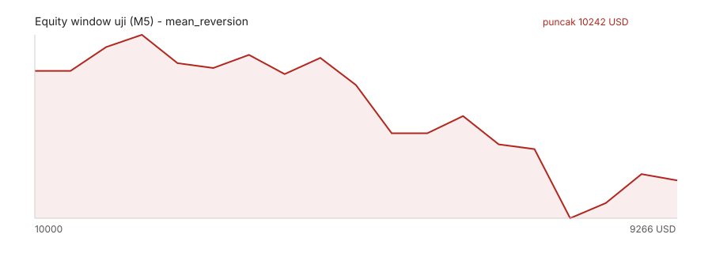
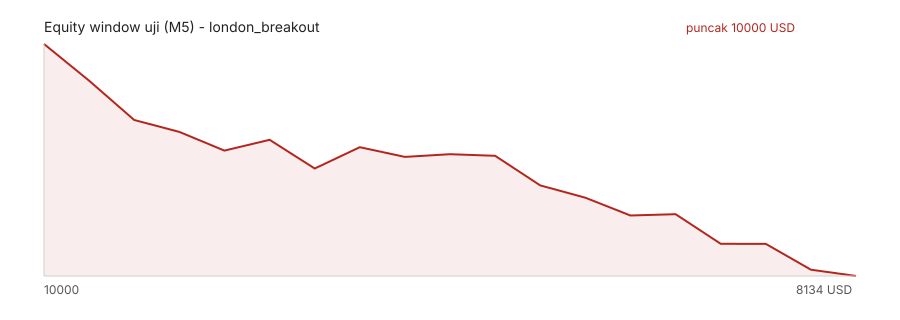
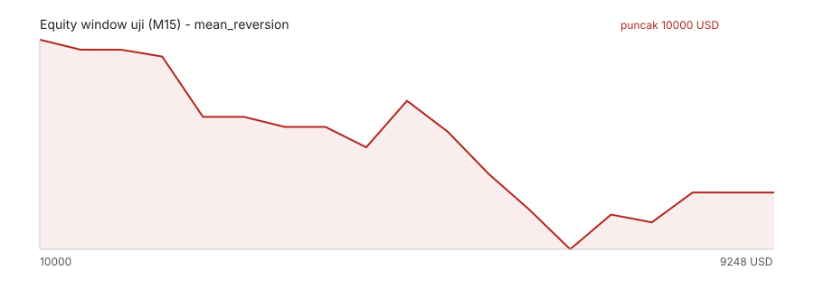
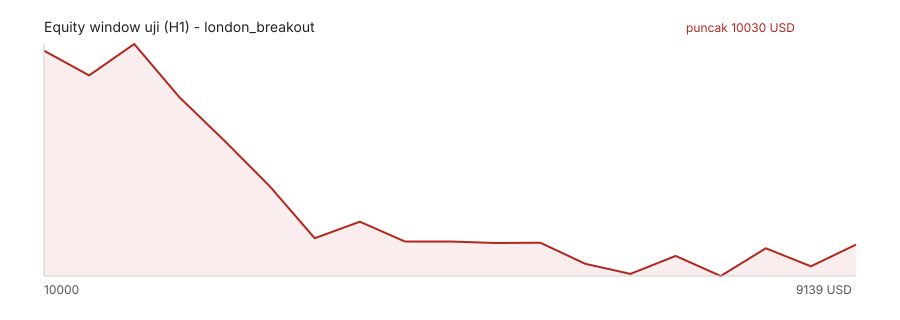

# Laporan DoD Gate P2 — Lumine Fund v2 (Fund Core)

| | |
| --- | --- |
| Tanggal | 2026-11-23 |
| Penilai | hf-ceo (koordinasi & review DoD, PRD §12) |
| Status | **P2 BELUM LULUS** — butir 1 GAGAL, butir 2 LULUS, butir 3 TERKIRIM |
| Sumber | `PRD_v2.1_Fund_Core.md` §11 (P2) — DoD: 1 strategi lolos backtest 2 tahun data dengan biaya realistis dan walk-forward; paritas sinyal backtest vs paper ≥ 99%; laporan terbaca owner |

## 1. Butir DoD P2

| # | Butir DoD | Status | Bukti |
| --- | --- | --- | --- |
| 1 | 1 strategi lolos backtest 2 tahun data dengan biaya realistis dan walk-forward | **GAGAL** | Walk-forward 2 tahun penuh (2024-11-01 .. 2026-11-20) dijalankan ulang hf-ceo pada 4 kombinasi strategi×TF dengan biaya terkalibrasi PRD 5.2. **Tidak ada yang lolos** kriteria yang dideklarasikan sebelum run (net>0, PF>1, expectancy>0, DD≤10%, trades≥30, ≤50% window PF<1). Detail §2. |
| 2 | Paritas sinyal backtest vs paper ≥ 99% | **LULUS** | `docs/QA_P2_paritas.md`: **100% (8/8 sinyal identik)** pada replay 5000 bar M5 terkontrol (27 Okt–20 Nov), target ≥99%; satu `decide()` untuk backtest & paper (T1 PASS). 3 temuan kritis QA sudah ditutup (F-1 `f191f07`, F-2 `b52b902`+`a0f9376`+`c2791e5`, F-3 `6f3c7fb`); runner di-restart pada HEAD `2861af4` (t_bb82c376). Paritas LIVE diulang sebagai QA setelah market London Senin hidup ≥1 hari. |
| 3 | Laporan terbaca owner | **TERKIRIM** | Laporan ini + `docs/QA_P2_paritas.md` + laporan per run (§2) diserahkan ke owner di chat kantor 23 Nov 2026; hasil disajikan ringkas: verdict, equity, kapan gagal. |

**Keputusan gate: P2 BELUM LULUS.** Butir 2 dan 3 terpenuhi; butir 1 tidak — tidak ada strategi yang bertahan melawan biaya realistis pada 2 tahun data. Lanjut ke P3/live TIDAK dibenarkan dengan strategi saat ini (gerbang B2: PF≥1.3, DD≤5% jauh tercapai).

## 2. Backtest 2 tahun — walk-forward (gate butir DoD 1)

Data: re-scope owner 23 Nov (opsi 2) — M5/M15 2 tahun, M1 tidak wajib. Saat verifikasi gate ditemukan **lubang data M5/M15 Feb–Sep 2026** (ekspor MT5 broker hanya sampai 18 Jan 2026 + 27 Okt–20 Nov 2026). Lubang diisi dari raw Dukascopy lokal 2 tahun yang sudah terunduh: +81.216 bar M5 (18 Jan–26 Okt) +160 bar (27 Okt pagi) + rollup M5→M15 +23.792 bar; bar live HFM 27 Okt+ tidak disentuh; validasi OHLC bersih. H1 kontinu 2 tahun dari ekspor MT5. Hasil:

| Strategi | TF | Net (USD) | PF | Trades | Max DD | Window profit | Verdict |
| --- | --- | --- | --- | --- | --- | --- | --- |
| #2 Mean Reversion | M5 | -733.65 | 0.837 | 185 | 11.99% | 7/18 | **GAGAL** |
| #1 London Breakout | M5 | -1866.15 | 0.686 | 233 | 18.66% | 4/18 | **GAGAL** |
| #2 Mean Reversion | M15 | -752.31 | 0.728 | 100 | 10.32% | 3/18 | **GAGAL** |
| #1 London Breakout | H1 | -860.56 | 0.693 | 98 | 10.26% | 6/18 | **GAGAL** |

Semua run: latih 6 bulan / uji 1 bulan geser 1 bulan (18 window uji), grid 12 kombinasi per window, parameter dipilih HANYA dari window latih, ekuiti berantai antar window, biaya terkalibrasi (spread per sesi Dukascopy×faktor HFM + haircut 20% = 0.516 USD; komisi 7 USD/lot round-turn; slippage 0.1 USD/fill), equity awal 10.000 USD, risiko 0.5%/trade. Determinisme terverifikasi: window yang datanya sama antara run pra-fill dan run data lengkap menghasilkan angka identik.

### #2 Mean Reversion di M5 — **GAGAL**

- Data: 2024-11-01 .. 2026-11-20 (213960 bar M5); walk-forward latih 6 bulan / uji 1 bulan, geser 1 bulan → 18 window uji.
- Run ID `d9706373-3353-4f50-a3e9-951306e9192f`; total percobaan tercatat di `backtest_runs`: 234 (grid 12 kombinasi/window + 1 uji).
- Biaya realistis (PRD 5.2, kalibrasi Dukascopy×HFM + haircut 20%): spread per sesi {'asia': 0.516, 'london': 0.516, 'london_newyork': 0.516, 'newyork': 0.516}, komisi 7.0 USD/lot round-turn, slippage 0.1 USD/fill.

| Metrik gabungan window uji | Nilai |
| --- | --- |
| Trades | 185 |
| Winrate | 0.373 |
| Profit factor | 0.837 |
| Expectancy | -3.97 USD/trade (-0.08 R) |
| Net profit (ekuiti berantai) | -733.65 USD |
| Max drawdown gabungan | 1228.39 USD (11.99%) |
| Window profit | 7/18 (PF<1: 9) |

| Kriteria lolos | Status |
| --- | --- |
| net profit > 0 | FAIL (-733.65 USD) |
| profit factor > 1.0 | FAIL (0.837) |
| expectancy > 0 | FAIL (-3.97 USD) |
| max drawdown <= 10% | FAIL (11.99%) |
| trades >= 30 | PASS (185) |
| maks 50% window PF<1 | FAIL (9/18) |

Window uji yang gagal (PF<1 / expectancy negatif / DD>10% / tanpa trade):

| # | Window | Trades | PF | Expectancy | Max DD | Net | Catatan |
| --- | --- | --- | --- | --- | --- | --- | --- |
| 1 | 2025-06-01..2025-07-01 | 0 | None | None | 0.00% | 0.0 | GAGAL: tidak ada trade di window uji |
| 4 | 2025-09-01..2025-10-01 | 20 | 0.595 | -9.51 | 2.72% | -190.28 | GAGAL: profit factor 0.595 < 1 setelah biaya |
| 5 | 2025-10-01..2025-11-01 | 6 | 0.806 | -5.37 | 1.45% | -32.24 | GAGAL: profit factor 0.806 < 1 setelah biaya |
| 7 | 2025-12-01..2026-01-01 | 6 | 0.347 | -21.43 | 1.73% | -128.6 | GAGAL: profit factor 0.347 < 1 setelah biaya |
| 9 | 2026-02-01..2026-03-01 | 7 | 0.25 | -26.01 | 2.00% | -182.07 | GAGAL: profit factor 0.25 < 1 setelah biaya |
| 10 | 2026-03-01..2026-04-01 | 7 | 0.0 | -46.08 | 3.26% | -322.59 | GAGAL: profit factor 0.0 < 1 setelah biaya |
| 11 | 2026-04-01..2026-05-01 | 0 | None | None | 0.00% | 0.0 | GAGAL: tidak ada trade di window uji |
| 13 | 2026-06-01..2026-07-01 | 20 | 0.676 | -9.46 | 3.31% | -189.2 | GAGAL: profit factor 0.676 < 1 setelah biaya |
| 14 | 2026-07-01..2026-08-01 | 22 | 0.94 | -1.46 | 3.61% | -32.03 | GAGAL: profit factor 0.94 < 1 setelah biaya |
| 15 | 2026-08-01..2026-09-01 | 20 | 0.302 | -23.14 | 4.95% | -462.71 | GAGAL: profit factor 0.302 < 1 setelah biaya |
| 16 | 2026-09-01..2026-10-01 | 2 | None | 50.7 | 0.00% | 101.41 | OK |
| 17 | 2026-10-01..2026-11-01 | 2 | None | 97.09 | 0.00% | 194.17 | OK |
| 18 | 2026-11-01..2026-12-01 | 1 | 0.0 | -42.71 | 0.46% | -42.71 | GAGAL: profit factor 0.0 < 1 setelah biaya |

### #1 London Breakout di M5 — **GAGAL**

- Data: 2024-11-01 .. 2026-11-20 (213960 bar M5); walk-forward latih 6 bulan / uji 1 bulan, geser 1 bulan → 18 window uji.
- Run ID `c6fb1cd2-1a42-4089-b5e9-1b1c5c8224f3`; total percobaan tercatat di `backtest_runs`: 234 (grid 12 kombinasi/window + 1 uji).
- Biaya realistis (PRD 5.2, kalibrasi Dukascopy×HFM + haircut 20%): spread per sesi {'asia': 0.516, 'london': 0.516, 'london_newyork': 0.516, 'newyork': 0.516}, komisi 7.0 USD/lot round-turn, slippage 0.1 USD/fill.

| Metrik gabungan window uji | Nilai |
| --- | --- |
| Trades | 233 |
| Winrate | 0.3305 |
| Profit factor | 0.686 |
| Expectancy | -8.01 USD/trade (-0.175 R) |
| Net profit (ekuiti berantai) | -1866.15 USD |
| Max drawdown gabungan | 1866.15 USD (18.66%) |
| Window profit | 4/18 (PF<1: 14) |

| Kriteria lolos | Status |
| --- | --- |
| net profit > 0 | FAIL (-1866.15 USD) |
| profit factor > 1.0 | FAIL (0.686) |
| expectancy > 0 | FAIL (-8.01 USD) |
| max drawdown <= 10% | FAIL (18.66%) |
| trades >= 30 | PASS (233) |
| maks 50% window PF<1 | FAIL (14/18) |

Window uji yang gagal (PF<1 / expectancy negatif / DD>10% / tanpa trade):

| # | Window | Trades | PF | Expectancy | Max DD | Net | Catatan |
| --- | --- | --- | --- | --- | --- | --- | --- |
| 1 | 2025-06-01..2025-07-01 | 13 | 0.276 | -22.7 | 3.43% | -295.11 | GAGAL: profit factor 0.276 < 1 setelah biaya |
| 2 | 2025-07-01..2025-08-01 | 18 | 0.245 | -17.55 | 3.26% | -315.95 | GAGAL: profit factor 0.245 < 1 setelah biaya |
| 3 | 2025-08-01..2025-09-01 | 15 | 0.681 | -6.41 | 2.00% | -96.12 | GAGAL: profit factor 0.681 < 1 setelah biaya |
| 4 | 2025-09-01..2025-10-01 | 14 | 0.596 | -10.74 | 2.65% | -150.4 | GAGAL: profit factor 0.596 < 1 setelah biaya |
| 6 | 2025-11-01..2025-12-01 | 13 | 0.381 | -17.71 | 2.50% | -230.27 | GAGAL: profit factor 0.381 < 1 setelah biaya |
| 8 | 2026-01-01..2026-02-01 | 7 | 0.618 | -11.11 | 2.21% | -77.77 | GAGAL: profit factor 0.618 < 1 setelah biaya |
| 10 | 2026-03-01..2026-04-01 | 9 | 0.95 | -1.42 | 2.34% | -12.81 | GAGAL: profit factor 0.95 < 1 setelah biaya |
| 11 | 2026-04-01..2026-05-01 | 14 | 0.5 | -16.97 | 3.74% | -237.64 | GAGAL: profit factor 0.5 < 1 setelah biaya |
| 12 | 2026-05-01..2026-06-01 | 13 | 0.751 | -7.62 | 3.36% | -99.12 | GAGAL: profit factor 0.751 < 1 setelah biaya |
| 13 | 2026-06-01..2026-07-01 | 14 | 0.672 | -10.21 | 2.59% | -142.93 | GAGAL: profit factor 0.672 < 1 setelah biaya |
| 15 | 2026-08-01..2026-09-01 | 13 | 0.409 | -18.31 | 2.98% | -237.98 | GAGAL: profit factor 0.409 < 1 setelah biaya |
| 16 | 2026-09-01..2026-10-01 | 20 | 0.999 | -0.03 | 2.60% | -0.51 | GAGAL: profit factor 0.999 < 1 setelah biaya |
| 17 | 2026-10-01..2026-11-01 | 14 | 0.439 | -14.83 | 3.38% | -207.56 | GAGAL: profit factor 0.439 < 1 setelah biaya |
| 18 | 2026-11-01..2026-12-01 | 12 | 0.82 | -4.25 | 2.25% | -50.98 | GAGAL: profit factor 0.82 < 1 setelah biaya |

### #2 Mean Reversion di M15 — **GAGAL**

- Data: 2024-11-01 .. 2026-11-20 (71320 bar M15); walk-forward latih 6 bulan / uji 1 bulan, geser 1 bulan → 18 window uji.
- Run ID `4c0d9fd9-d943-42df-8797-3f52d2e1f2b6`; total percobaan tercatat di `backtest_runs`: 234 (grid 12 kombinasi/window + 1 uji).
- Biaya realistis (PRD 5.2, kalibrasi Dukascopy×HFM + haircut 20%): spread per sesi {'asia': 0.516, 'london': 0.516, 'london_newyork': 0.516, 'newyork': 0.516}, komisi 7.0 USD/lot round-turn, slippage 0.1 USD/fill.

| Metrik gabungan window uji | Nilai |
| --- | --- |
| Trades | 100 |
| Winrate | 0.35 |
| Profit factor | 0.728 |
| Expectancy | -7.52 USD/trade (-0.153 R) |
| Net profit (ekuiti berantai) | -752.31 USD |
| Max drawdown gabungan | 1031.7 USD (10.32%) |
| Window profit | 3/18 (PF<1: 12) |

| Kriteria lolos | Status |
| --- | --- |
| net profit > 0 | FAIL (-752.31 USD) |
| profit factor > 1.0 | FAIL (0.728) |
| expectancy > 0 | FAIL (-7.52 USD) |
| max drawdown <= 10% | FAIL (10.32%) |
| trades >= 30 | PASS (100) |
| maks 50% window PF<1 | FAIL (12/18) |

Window uji yang gagal (PF<1 / expectancy negatif / DD>10% / tanpa trade):

| # | Window | Trades | PF | Expectancy | Max DD | Net | Catatan |
| --- | --- | --- | --- | --- | --- | --- | --- |
| 1 | 2025-06-01..2025-07-01 | 4 | 0.51 | -12.24 | 0.78% | -48.96 | GAGAL: profit factor 0.51 < 1 setelah biaya |
| 2 | 2025-07-01..2025-08-01 | 5 | 0.998 | -0.04 | 0.95% | -0.21 | GAGAL: profit factor 0.998 < 1 setelah biaya |
| 3 | 2025-08-01..2025-09-01 | 1 | 0.0 | -33.33 | 0.33% | -33.33 | GAGAL: profit factor 0.0 < 1 setelah biaya |
| 4 | 2025-09-01..2025-10-01 | 11 | 0.149 | -27.01 | 3.03% | -297.06 | GAGAL: profit factor 0.149 < 1 setelah biaya |
| 5 | 2025-10-01..2025-11-01 | 0 | None | None | 0.00% | 0.0 | GAGAL: tidak ada trade di window uji |
| 6 | 2025-11-01..2025-12-01 | 1 | 0.0 | -49.46 | 0.51% | -49.46 | GAGAL: profit factor 0.0 < 1 setelah biaya |
| 7 | 2025-12-01..2026-01-01 | 0 | None | None | 0.00% | 0.0 | GAGAL: tidak ada trade di window uji |
| 8 | 2026-01-01..2026-02-01 | 2 | 0.0 | -50.2 | 1.05% | -100.41 | GAGAL: profit factor 0.0 < 1 setelah biaya |
| 10 | 2026-03-01..2026-04-01 | 9 | 0.522 | -16.97 | 1.75% | -152.73 | GAGAL: profit factor 0.522 < 1 setelah biaya |
| 11 | 2026-04-01..2026-05-01 | 8 | 0.308 | -25.87 | 3.10% | -206.98 | GAGAL: profit factor 0.308 < 1 setelah biaya |
| 12 | 2026-05-01..2026-06-01 | 12 | 0.549 | -14.7 | 2.74% | -176.45 | GAGAL: profit factor 0.549 < 1 setelah biaya |
| 13 | 2026-06-01..2026-07-01 | 13 | 0.547 | -15.0 | 2.43% | -194.98 | GAGAL: profit factor 0.547 < 1 setelah biaya |
| 15 | 2026-08-01..2026-09-01 | 5 | 0.593 | -7.6 | 1.00% | -38.0 | GAGAL: profit factor 0.593 < 1 setelah biaya |
| 17 | 2026-10-01..2026-11-01 | 3 | 0.992 | -0.12 | 0.48% | -0.35 | GAGAL: profit factor 0.992 < 1 setelah biaya |
| 18 | 2026-11-01..2026-12-01 | 0 | None | None | 0.00% | 0.0 | GAGAL: tidak ada trade di window uji |

### #1 London Breakout di H1 — **GAGAL**

- Data: 2024-11-01 .. 2026-11-20 (15632 bar H1); walk-forward latih 6 bulan / uji 1 bulan, geser 1 bulan → 18 window uji.
- Run ID `4245e9cb-848e-4980-9821-dc0fe4e387c8`; total percobaan tercatat di `backtest_runs`: 234 (grid 12 kombinasi/window + 1 uji).
- Biaya realistis (PRD 5.2, kalibrasi Dukascopy×HFM + haircut 20%): spread per sesi {'asia': 0.516, 'london': 0.516, 'london_newyork': 0.516, 'newyork': 0.516}, komisi 7.0 USD/lot round-turn, slippage 0.1 USD/fill.

| Metrik gabungan window uji | Nilai |
| --- | --- |
| Trades | 98 |
| Winrate | 0.3469 |
| Profit factor | 0.693 |
| Expectancy | -8.78 USD/trade (-0.181 R) |
| Net profit (ekuiti berantai) | -860.56 USD |
| Max drawdown gabungan | 1029.14 USD (10.26%) |
| Window profit | 6/18 (PF<1: 11) |

| Kriteria lolos | Status |
| --- | --- |
| net profit > 0 | FAIL (-860.56 USD) |
| profit factor > 1.0 | FAIL (0.693) |
| expectancy > 0 | FAIL (-8.78 USD) |
| max drawdown <= 10% | FAIL (10.26%) |
| trades >= 30 | PASS (98) |
| maks 50% window PF<1 | FAIL (11/18) |

Window uji yang gagal (PF<1 / expectancy negatif / DD>10% / tanpa trade):

| # | Window | Trades | PF | Expectancy | Max DD | Net | Catatan |
| --- | --- | --- | --- | --- | --- | --- | --- |
| 1 | 2025-06-01..2025-07-01 | 8 | 0.616 | -13.7 | 2.83% | -109.62 | GAGAL: profit factor 0.616 < 1 setelah biaya |
| 3 | 2025-08-01..2025-09-01 | 12 | 0.422 | -19.61 | 2.44% | -235.33 | GAGAL: profit factor 0.422 < 1 setelah biaya |
| 4 | 2025-09-01..2025-10-01 | 12 | 0.453 | -16.14 | 2.35% | -193.72 | GAGAL: profit factor 0.453 < 1 setelah biaya |
| 5 | 2025-10-01..2025-11-01 | 8 | 0.271 | -25.16 | 2.48% | -201.25 | GAGAL: profit factor 0.271 < 1 setelah biaya |
| 6 | 2025-11-01..2025-12-01 | 7 | 0.128 | -33.05 | 2.46% | -231.33 | GAGAL: profit factor 0.128 < 1 setelah biaya |
| 8 | 2026-01-01..2026-02-01 | 4 | 0.321 | -21.95 | 1.39% | -87.79 | GAGAL: profit factor 0.321 < 1 setelah biaya |
| 9 | 2026-02-01..2026-03-01 | 0 | None | None | 0.00% | 0.0 | GAGAL: tidak ada trade di window uji |
| 10 | 2026-03-01..2026-04-01 | 2 | 0.839 | -3.44 | 0.47% | -6.88 | GAGAL: profit factor 0.839 < 1 setelah biaya |
| 12 | 2026-05-01..2026-06-01 | 4 | 0.268 | -23.46 | 1.40% | -93.86 | GAGAL: profit factor 0.268 < 1 setelah biaya |
| 13 | 2026-06-01..2026-07-01 | 3 | 0.43 | -14.97 | 0.87% | -44.91 | GAGAL: profit factor 0.43 < 1 setelah biaya |
| 15 | 2026-08-01..2026-09-01 | 2 | 0.0 | -44.59 | 0.98% | -89.19 | GAGAL: profit factor 0.0 < 1 setelah biaya |
| 17 | 2026-10-01..2026-11-01 | 5 | 0.469 | -15.99 | 1.65% | -79.93 | GAGAL: profit factor 0.469 < 1 setelah biaya |

## 3. Apa yang dipelajari (jujur, PRD 5.4)

- **Keuntungan jendela pendek tidak generalisasi.** Pada 25 hari M5 (laporan perbandingan t_f2p2a4) #2 unggul +116.30 dan #1 +43.51 setelah biaya; pada 2 tahun penuh keduanya rugi setelah biaya (net -733.65 s.d. -1.866.15). Edge yang terlihat di sampel pendek tidak bertahan.
- **Kalah di biaya.** Semua run PF 0.69–0.84 setelah biaya: rata-rata trade rugi. Biaya ~7 USD per round-trade di 0.10 lot (spread 0.516 + komisi + slippage) memakan edge yang tipis; frekuensi trade tinggi (100-233 trade) memperbesar eksposur biaya.
- **Tidak ada edge di window latih juga.** Banyak window latih punya expectancy negatif (PF latih 0.45–0.8) — pemilih parameter hanya memilih "paling tidak buruk"; ini indikasi strategi tidak punya edge robust pada data ini, bukan bug harness (engine terverifikasi test_costs + test_walkforward, dan paritas `decide()` 100%).
- **Drawdown melampaui ambang.** DD gabungan 10.3–18.7% vs ambang auto-halt 10% (PRD 5.6) — 3 dari 4 run di atas ambang.
- **Kapan gagal:** window rugi menyebar di seluruh 2025-2026 (lihat tabel per run di atas) — bukan satu periode ekstrem; pola loss tidak musiman yang jelas.
- P3 (ML/RL) prinsip PRD berlaku analog: "Jika tidak lolos: arsipkan, laporkan apa yang dipelajari. Itu hasil sah."

## 4. Paritas backtest vs paper (gate butir DoD 2) — LULUS 100%

- **`docs/QA_P2_paritas.md` (22 Nov): LULUS 100% ≥ 99%** pada replay terkontrol 5000 bar M5 — 8/8 sinyal identik (side, volume, SL, TP, bar waktu), risk gate 0 penolakan di kedua jalur, satu objek fungsi `decide()`.
- 3 temuan kritis QA ditutup dan disetujui Direktur: F-1 crash `insert_order` → `f191f07` + 3 regression test; F-2 feed M5 mati → rollup M1→M5 server-side + freeze guard + filter simbol (`b52b902`, `a0f9376`, `c2791e5`; 289 test lulus); F-3 runner tanpa supervisi → `fund2-paper-runner.service` Restart=always + health check Telegram (`6f3c7fb`).
- Runner di-restart 23 Nov 02:50 WIB pada HEAD `2861af4` (t_bb82c376, review) — status active, dua strategi normal, menunggu market buka Senin 05:00 WIB.
- **Paritas LIVE** menyusul (QA ulang setelah London hidup ≥1 hari) — watcher candle M5 + health check runner aktif.

## 5. Cakupan 7 baris tugas P2 (PRD §11)

| Tugas | Owner | Bukti keluaran |
| --- | --- | --- |
| Skill `data-crawler` → parquet + `candles`, validasi gap/duplikat | hf-devops | Re-scope owner 23 Nov (opsi 2): ekspor MT5 M5/H1 2 thn + rollup M5→M15; **gate menemukan & menutup lubang Feb–Sep 2026 dari raw Dukascopy lokal** (+81.376 bar M5, +23.792 bar M15; validasi OHLC bersih) — baseline 2 tahun kini kontinu |
| Backtest engine event-driven (satu `decide()`), model biaya terkalibrasi (5.2) | hf-backend | Commit `2046bd0`; engine + cost model per sesi strategy-aware; dipakai penuh di gate ini |
| Walk-forward runner + `backtest_runs` | hf-backend | Commit `33dad1d`; registry kini **1690 baris** (7 run gate × 234 + 52 sebelumnya) — seluruh percobaan teraudit |
| Format skill strategi final + template `strategy-author` | hf-backend | Commit `737657d`/`aae4faa`; `strategies/README.md` + `_template` |
| Laporan backtest owner-readable (ringkasan + equity + kapan gagal) | hf-frontend / hf-backend | `scripts/report_backtest_p2.py` + laporan ini + laporan per run (§2) |
| Strategi #2 (mean reversion) untuk perbandingan | hf-backend | Commit `d5f4e8a`; perbandingan jendela pendek M5 #2 +116.30 vs #1 +43.51; keduanya gagal di 2 tahun |
| QA: verifikasi paritas backtest vs paper | hf-qa | Commit `e326566`; `docs/QA_P2_paritas.md` — 100% (8/8); 3 temuan kritis ditutup |

## 6. Catatan & keputusan terbuka untuk owner

- **Butir DoD 1 gagal** — ini hasil riset yang sah, bukan kegagalan eksekusi: infrastruktur (engine, walk-forward, registry, paritas) terbangun dan terverifikasi; strateginya yang tidak lolos.
- **Opsi keputusan**: (a) iterasi desain strategi (target expectancy per trade lebih tinggi / frekuensi lebih rendah agar biaya tidak memakan edge; wajib lolos kriteria yang sama sebelum lanjut); (b) terima kegagalan & arsipkan pembelajaran, fokus ke gerbang paper tanpa strategi baru; (c) arah lain yang owner putuskan. Live dengan strategi saat ini TIDAK dibenarkan (gerbang B2 PF≥1.3/DD≤5% jauh tercapai).
- **Provenance data**: M5/M15 Feb–Sep 2026 + 27 Okt pagi dari raw Dukascopy lokal (level harga bisa beda ~$2 dari HFM di batas sumber; strategi force-close harian 16:00 UTC sehingga artefak batas tidak melintang hari); sisanya ekspor MT5 HFM. Kalibrasi biaya dari 1.081.440 menit spread Dukascopy + sampel HFM yang masih pendek — faktor wajib dikalibrasi ulang saat data HFM bertambah.
- Dukascopy loader tidak siap produksi (API 429) — tidak menghalangi DoD karena data dari raw lokal + ekspor MT5.
- Paritas LIVE & gerbang paper ≥20 hari kerja + ≥100 trade (B2) tetap prasyarat sebelum diskusi live mana pun.

## 7. Keputusan

**Gerbang P2: P2 BELUM LULUS** — butir 1 (strategi lolos 2 tahun) GAGAL dengan bukti lengkap; butir 2 (paritas ≥99%) LULUS 100%; butir 3 (laporan owner) TERKIRIM. Fase tidak lanjut ke live/P3 dengan strategi saat ini; keputusan arah menunggu owner (§6).
